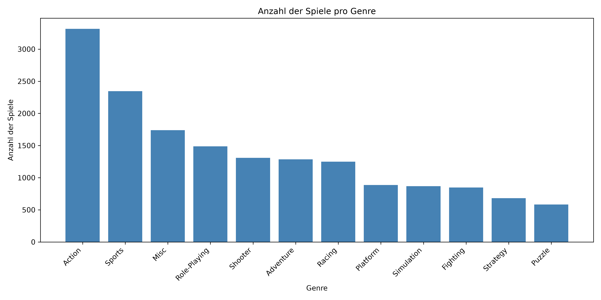
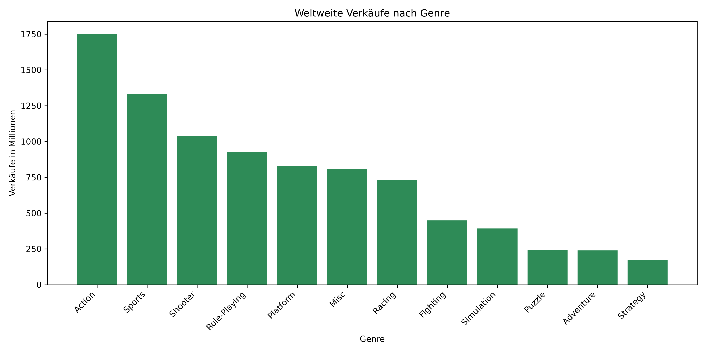
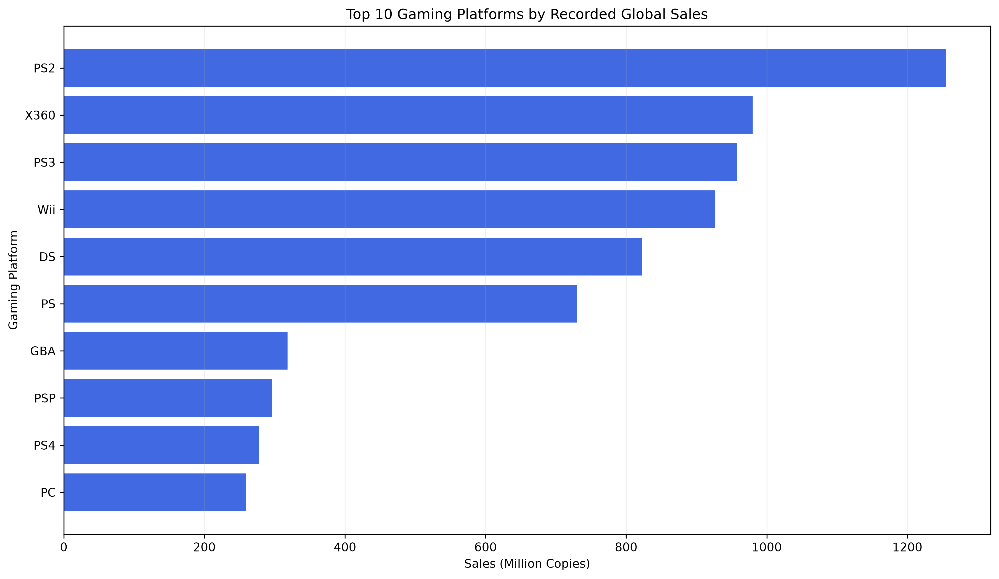
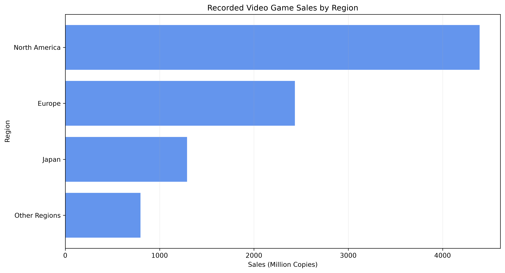
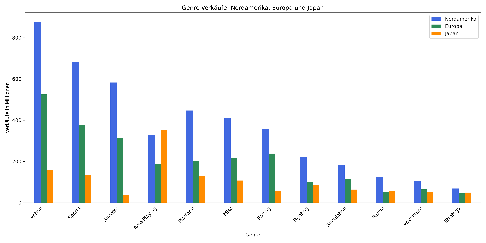
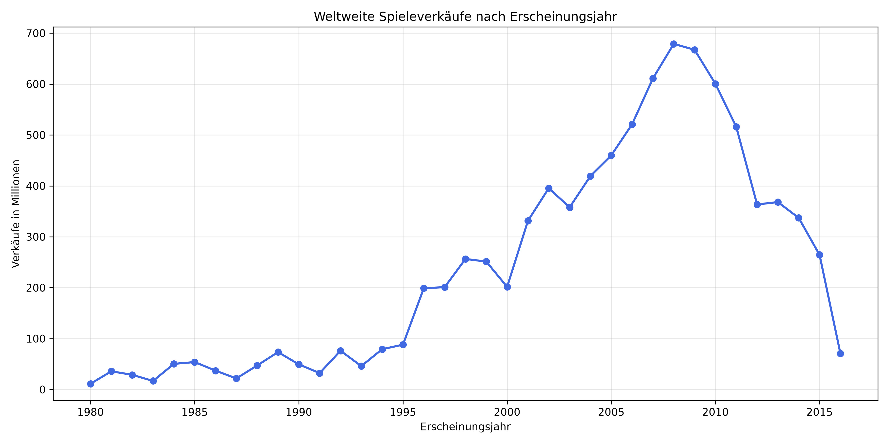
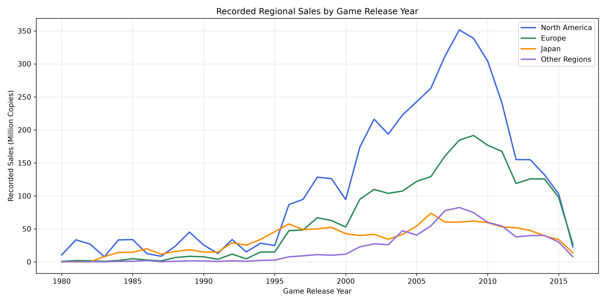
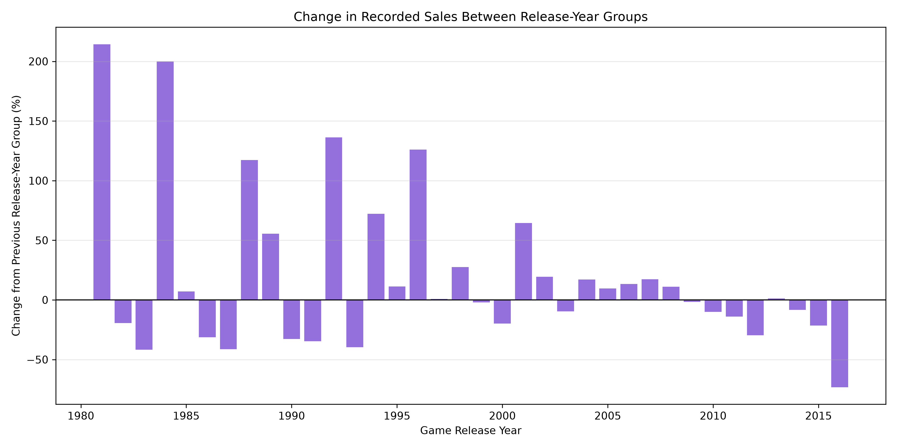

# 🎮 Game Sales Analytics

**An interactive Data Analytics project for exploring historical video game sales using Python, Pandas, SQLite, Streamlit, and Plotly.**

This project demonstrates a complete data analytics workflow, including data preprocessing, exploratory data analysis, SQL database integration, and interactive dashboard development.

## 📖 Project Overview

Game Sales Analytics is a Python-based project designed to analyze historical video game sales across different genres, gaming platforms, publishers, regions, and release years.

The project transforms raw CSV data into structured, cleaned datasets, stores the processed information in a SQLite database, and presents the results through an interactive Streamlit dashboard.

The main goal is to develop practical skills in data analytics, data science, database management, and Python software engineering.

## ✨ Features

### 📊 Exploratory Data Analysis
- Analyze global video game sales
- Identify best-selling games and genres
- Compare gaming platforms
- Explore publisher performance
- Analyze regional sales distribution
- Visualize sales grouped by release year
- Generate charts using Matplotlib

### 🧹 Data Cleaning
- Identify and analyze missing values
- Handle missing release years
- Replace missing publisher information
- Detect and remove duplicate records
- Convert data types
- Export cleaned datasets

### 🗄️ SQL Database
- Store cleaned video game data in SQLite
- Query game information using SQL
- Filter records with `WHERE`
- Group results with `GROUP BY`
- Calculate totals using `SUM()`
- Calculate averages using `AVG()`
- Sort results using `ORDER BY`
- Filter aggregated results using `HAVING`

### 🌐 Interactive Streamlit Dashboard
- Interactive genre filtering
- Platform selection
- Release-year range slider
- Dynamic sales statistics
- Interactive Plotly charts
- Regional sales comparison
- Top 10 best-selling game entries
- Sales analysis by release year
- Interactive data table
- CSV export of filtered results

## 🛠️ Tech Stack

| Technology | Purpose |
|---|---|
| Python | Core programming language |
| Pandas | Data manipulation and analysis |
| NumPy | Numerical computing |
| Matplotlib | Static data visualizations |
| Plotly | Interactive visualizations |
| Streamlit | Web dashboard |
| SQLite | Database storage |
| SQL | Data querying |
| Git | Version control |
| GitHub | Source code hosting |

## 📁 Project Structure

```text
game-sales-analysis/
│
├── data/
│   ├── raw/
│   └── processed/
│
├── database/
│   └── games.db
│
├── dashboard/
│   ├── app.py
│   └── data_loader.py
│
├── images/
│   ├── genre_counts.png
│   ├── genre_sales.png
│   ├── regional_sales.png
│   ├── genre_region_comparison.png
│   ├── top_10_platforms.png
│   ├── yearly_global_sales.png
│   ├── yearly_regional_sales.png
│   └── yearly_sales_growth.png
│
├── notebooks/
│
├── src/
│   ├── database_setup.py
│   ├── sql_analysis.py
│   ├── platform_analysis.py
│   ├── regional_analysis.py
│   └── time_analysis.py
│
├── main.py
├── requirements.txt
├── .gitignore
└── README.md
```

**Note:** The database and dataset files are generated or downloaded locally and are not included in the Git repository.

## 📦 Dataset

**Dataset:** Video Game Sales

**Source:** [Kaggle – Video Game Sales](https://www.kaggle.com/datasets/gregorut/videogamesales)

The original dataset contains approximately 16,600 game entries and includes:

| Column | Description |
|---|---|
| Rank | Sales ranking |
| Name | Video game title |
| Platform | Gaming platform |
| Year | Release year |
| Genre | Game genre |
| Publisher | Publishing company |
| NA_Sales | North American sales |
| EU_Sales | European sales |
| JP_Sales | Japanese sales |
| Other_Sales | Sales in other regions |
| Global_Sales | Worldwide sales |

Sales values are expressed in **millions of copies**.

The dataset is historical and does not provide current sales information. Aggregating sales by release year does not represent actual sales transactions within that calendar year.

## ⚙️ Installation

### 1. Clone the repository

```bash
git clone https://github.com/Kolbinger-sk/game-sales-analysis.git
cd game-sales-analysis
```

### 2. Create a virtual environment

```bash
python -m venv .venv
```

Activate it on Windows:

```powershell
.\.venv\Scripts\Activate.ps1
```

Activate it on macOS/Linux:

```bash
source .venv/bin/activate
```

### 3. Install dependencies

```bash
python -m pip install -r requirements.txt
```

### 4. Download the dataset

Download the dataset from [Kaggle](https://www.kaggle.com/datasets/gregorut/videogamesales).

Place the CSV file at:

```text
data/raw/vgsales.csv
```

### 5. Clean and process the data

Run the main analysis script:

```bash
python main.py
```

This generates the cleaned dataset:

```text
data/processed/vgsales_clean.csv
```

### 6. Create the SQLite database

```bash
python src/database_setup.py
```

This creates:

```text
database/games.db
```

### 7. Run SQL analysis

```bash
python src/sql_analysis.py
```

### 8. Launch the Streamlit dashboard

```bash
python -m streamlit run dashboard/app.py
```

Open your browser at:

```text
http://localhost:8501
```

## 📸 Visualizations

The project includes several visualizations generated using Matplotlib.

### Games by Genre



### Global Sales by Genre



### Top 10 Gaming Platforms



### Regional Sales



### Regional Genre Comparison



### Global Sales by Release Year



### Regional Sales by Release Year



### Sales Change by Release Year



## 🧠 SQL Analysis Examples

### Top 10 Best-Selling Game Entries

```sql
SELECT
    Name,
    Platform,
    Global_Sales
FROM games
ORDER BY Global_Sales DESC
LIMIT 10;
```

### Global Sales by Genre

```sql
SELECT
    Genre,
    COUNT(*) AS Game_Count,
    ROUND(SUM(Global_Sales), 2) AS Total_Sales
FROM games
GROUP BY Genre
ORDER BY Total_Sales DESC;
```

### Average Sales by Genre

```sql
SELECT
    Genre,
    ROUND(AVG(Global_Sales), 2) AS Average_Sales
FROM games
GROUP BY Genre
ORDER BY Average_Sales DESC;
```

## 🗺️ Development Roadmap

### Completed
- [x] Python project setup
- [x] Data loading with Pandas
- [x] Data exploration
- [x] Data cleaning
- [x] Genre sales analysis
- [x] Platform sales analysis
- [x] Regional sales analysis
- [x] Release-year analysis
- [x] Matplotlib visualizations
- [x] SQLite database integration
- [x] Advanced SQL queries
- [x] Interactive Streamlit dashboard v1.3
- [x] Centralized database loader
- [x] GitHub repository setup

### Planned
- [ ] Multipage Streamlit dashboard
- [ ] Advanced game search
- [ ] Interactive platform comparisons
- [ ] Dashboard UI improvements
- [ ] Machine learning experiments
- [ ] Sales prediction model evaluation
- [ ] Automated tests
- [ ] Application deployment

## 🎯 Learning Objectives

This project focuses on developing practical knowledge in:

- Python programming
- Data preprocessing
- Exploratory data analysis
- Data visualization
- SQL databases
- Interactive web applications
- Machine learning fundamentals
- Modular software architecture
- Git and GitHub workflows

## ⚠️ Data Limitations

The dataset contains historical records with incomplete coverage of the video game market.

The results should not be interpreted as current market statistics or complete industry-wide sales figures.

Some game titles appear multiple times because they were released on different platforms. Analyses generally operate on game-platform entries rather than unique game titles.

## 📌 Project Status

**Current version: 1.3**

The project currently includes a working interactive dashboard with an SQLite backend, data filters, visualizations, and CSV export.

The next major milestone is the development of a multipage dashboard with dedicated analytics sections.

## 👤 Author

**Kolbinger-sk**

GitHub: [github.com/Kolbinger-sk](https://github.com/Kolbinger-sk)

---

**Built with Python, Pandas, SQLite, Streamlit, and Plotly.**

*An ongoing Data Analytics and Data Science learning project.*